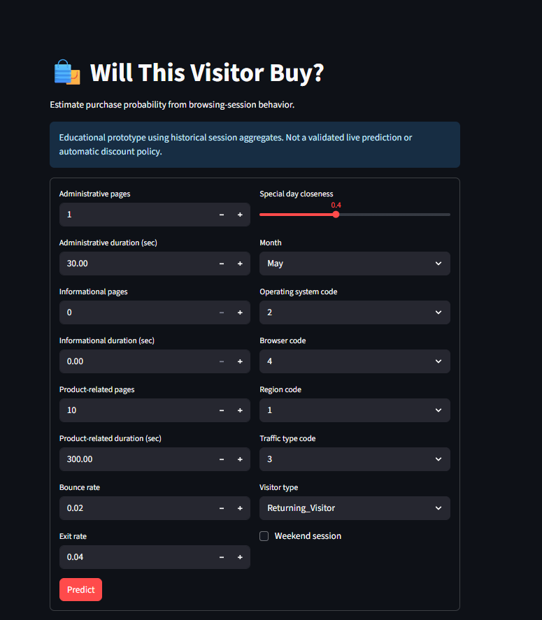
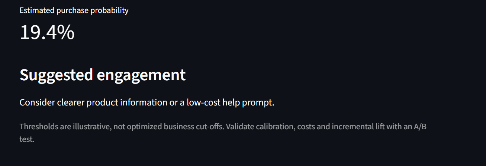

# Will This Visitor Buy? — E-Commerce Purchase Intent Prediction

Predict the probability that a historical e-commerce browsing session ended in a purchase, using the UCI Online Shoppers Purchasing Intention dataset. This project is an educational decision-support prototype, not a validated live prediction system.

**Live application:** [https://ecommerce-purchase-intent-prediction-kmstr57kdkbvvtffwkrtzd.streamlit.app/](https://ecommerce-purchase-intent-prediction-kmstr57kdkbvvtffwkrtzd.streamlit.app/)

**GitHub repository:** [Safaa-cloud/ecommerce-purchase-intent-prediction](https://github.com/Safaa-cloud/ecommerce-purchase-intent-prediction)




## Business problem

Online stores see many sessions that do not end in a purchase. Customer-engagement teams need to decide where optional guidance may be worth testing. This classifier estimates session-level purchase likelihood to support that discussion. A false positive may waste staff attention or incentive cost; a false negative may miss a chance to offer help. A prediction alone does not show that a coupon or chat causes an incremental sale.

## Project objectives

- Understand the dataset and purchase-class imbalance.
- Explore session activity and its descriptive relationship with purchase outcomes.
- Build leakage-aware preprocessing and compare a simple baseline with three classifiers.
- Use stratified cross-validation and training-only hyperparameter search.
- Evaluate the selected model once on a held-out test set.
- Save the complete preprocessing and model pipeline and provide a Streamlit interface.

## Dataset

The [UCI Online Shoppers Purchasing Intention dataset](https://archive.ics.uci.edu/dataset/468/online+shoppers+purchasing+intention+dataset) contains **12,330 sessions**, 17 predictors and the binary `Revenue` target. `False` / `0` means no purchase; `True` / `1` means purchase. There are 10,422 non-purchase sessions (84.5%) and 1,908 purchase sessions (15.5%). The CSV has no missing values and 125 duplicate rows. Duplicates are retained to match the supplied dataset and reproduce the split used for the recorded results.

The predictors describe administrative, informational and product-related page counts and durations; bounce and exit rates; special-day proximity; month; operating system, browser, region and traffic codes; visitor type; and weekend status. `PageValues` exists in the source but is excluded from model inputs (see preprocessing).

Citation: Sakar, C. & Kastro, Y. (2018). *Online Shoppers Purchasing Intention Dataset*. UCI Machine Learning Repository. [DOI: 10.24432/C5F88Q](https://doi.org/10.24432/C5F88Q). License: CC BY 4.0.

## Exploratory data analysis

The findings below come from the notebook's charts and calculations on the supplied dataset:

- Purchasers viewed a median of **29** product-related pages, compared with **16** for non-purchasers. Median product-page duration was **1,109.9 seconds** for purchasers and **510.2 seconds** for non-purchasers.
- Median bounce rate was **0.0000** among purchasers and **0.0043** among non-purchasers. Median exit rates were **0.0160** and **0.0286**, respectively.
- The observed purchase rate was **24.9%** for new visitors and **13.9%** for returning visitors.
- Purchase rates varied by month. These are descriptive historical patterns, not causal effects; small monthly samples can make individual month rates unstable.

## Preprocessing and leakage prevention

The workflow splits the data first using a stratified 80/20 train/test split (`random_state=42`). Imputers, scaler and encoder are fitted within scikit-learn pipelines on training folds only. Numeric features use median imputation and standardization. Categorical features use most-frequent imputation and one-hot encoding with unknown categories ignored. The model artifact contains the preprocessing steps and classifier together.

`PageValues` is excluded because it represents the average value of pages visited before a transaction and may encode outcome-related information. It may also be unavailable at the intended intervention time. The dataset contains session aggregates, so it does not establish what was known at each moment during a live session.

## Models and comparison

The table reproduces `reports/model_comparison.csv`. Cross-validation F1 is the best mean F1 from stratified five-fold cross-validation on training data. All test metrics use the same untouched held-out test split and probability threshold of 0.50.

| Model | Best CV F1 | Test precision | Test recall | Test F1 | Test ROC-AUC | Test PR-AUC |
|---|---:|---:|---:|---:|---:|---:|
| Dummy Classifier (majority) | — | 0.0000 | 0.0000 | 0.0000 | — | — |
| Logistic Regression | 0.3861 | 0.2487 | 0.7356 | 0.3717 | 0.7317 | 0.3116 |
| Random Forest | **0.4176** | 0.3008 | 0.4764 | 0.3688 | 0.7548 | 0.3425 |
| Extra Trees | 0.4157 | 0.3092 | 0.5707 | **0.4011** | 0.7548 | 0.3565 |

Random Forest was selected using the highest training-only cross-validation F1. Extra Trees scored a higher test F1 on this one split; the held-out test set was reserved for final comparison and was not used to choose the model. This difference is a reason to present both validation and test evidence.

### Selected model and held-out results

The selected Random Forest used `n_estimators=200`, `max_depth=12` and `min_samples_leaf=3`.

| Test metric | Result |
|---|---:|
| Precision | 0.3008 |
| Recall | 0.4764 |
| F1 | 0.3688 |
| ROC-AUC | 0.7548 |
| PR-AUC (average precision) | 0.3425 |
| Threshold | 0.50 |

Confusion matrix, with actual labels as rows and predicted labels as columns (`No purchase`, `Purchase`):

|  | Predicted no purchase | Predicted purchase |
|---|---:|---:|
| Actual no purchase | 1,661 (true negatives) | 423 (false positives) |
| Actual purchase | 200 (false negatives) | 182 (true positives) |

### What the metrics mean

- **Precision (30.1%)**: of sessions flagged as purchases, the share that actually purchased. Low precision means many false-positive flags.
- **Recall (47.6%)**: of all purchasing sessions, the share identified by the model. The model misses 200 of 382 purchasers at this threshold.
- **F1 (36.9%)**: the harmonic mean of precision and recall. It summarizes the balance between false-positive and false-negative behavior for the purchase class.
- **ROC-AUC (0.7548)**: how well the score ranks purchasing sessions above non-purchasing sessions across thresholds. It does not select a business threshold.
- **PR-AUC (0.3425)**: precision-recall summary for the purchase class. It is useful for this imbalanced dataset; the purchase prevalence is about 0.155.

Accuracy alone would hide the baseline's failure: the majority Dummy model predicts no purchases and has zero purchase recall and F1.



## Business recommendations

- Treat the score as one signal for evaluating low-cost optional help, such as clearer product guidance or chat.
- Compare false-positive costs (unneeded staff attention or incentives) with false-negative costs (missed opportunities to help) before selecting a threshold.
- Do not automatically offer discounts from the score. The model does not estimate incremental lift or coupon profitability.
- Validate calibration and threshold choices on timestamped, pre-intervention data, then test any assistance policy with randomized experiments.

## Limitations

- The source is historical, session-level aggregate data, not a live event stream.
- Results do not demonstrate real-time performance, calibration, causal impact or sales lift.
- `PageValues` is excluded due to leakage and availability concerns, but other aggregates also need timestamp-aware validation before a real-time interpretation.
- The held-out metrics depend on one random stratified split and may not generalize across time, websites or user groups.
- The app is an educational prototype. The author reports that the deployed prediction error has been fixed; verify the live page before relying on it for any real intervention.

## Installation

Use **Python 3.12.x**. The serialized pipeline was created with scikit-learn **1.7.2**. All project dependencies are exactly pinned in `requirements.txt` so model training and app inference use the same core versions. `.python-version` records Python 3.12.0 for local version managers.

```bash
python -m venv .venv
# Windows PowerShell:
.venv\Scripts\Activate.ps1
# macOS/Linux:
# source .venv/bin/activate
python -m pip install --upgrade pip
python -m pip install -r requirements.txt
```

## Run the notebook

From the project root:

```bash
python -m jupyter notebook notebooks/purchase_intent_analysis.ipynb
```

In Jupyter, choose **Restart Kernel and Run All Cells**. If the local CSV is absent, the notebook downloads dataset 468 using `ucimlrepo` and requires network access.

To rerun the model workflow and regenerate the joblib pipeline and reports instead:

```bash
python src/train.py
```

## Run the Streamlit application

The saved artifact `models/purchase_intent_pipeline.joblib` is required.

```bash
python -m streamlit run app.py
```

The app accepts 16 session features, displays its predicted class and estimated purchase probability, and provides an illustrative engagement suggestion. It checks the Python and scikit-learn runtime versions before loading the artifact and reports full load/prediction exceptions if something fails. The thresholds are examples and are not validated business rules.

### Model compatibility

The joblib model records scikit-learn **1.7.2** in its estimator state. `requirements.txt` pins the training and serving dependencies, and `app.py` displays its Python/scikit-learn versions and stops with an explicit message if they do not match. The app was updated to address the previously reported compatibility problem; the author reports that the deployed version now predicts successfully. The model artifact and evaluation results were preserved; no metrics were edited or model retraining was needed.

## GitHub and Streamlit Community Cloud

Project repository: [github.com/Safaa-cloud/ecommerce-purchase-intent-prediction](https://github.com/Safaa-cloud/ecommerce-purchase-intent-prediction). Live demo: [ecommerce-purchase-intent-prediction-kmstr57kdkbvvtffwkrtzd.streamlit.app](https://ecommerce-purchase-intent-prediction-kmstr57kdkbvvtffwkrtzd.streamlit.app/).  Include `models/purchase_intent_pipeline.joblib` when publishing because the app loads this artifact at startup. For reproducible deployment, select **Python 3.12** in Streamlit Community Cloud's Advanced settings and use `app.py` as the entrypoint. `.python-version` helps local tools; select the Python version explicitly in Cloud. Confirm the app's runtime caption shows Python 3.12.x and scikit-learn 1.7.2 after deployment.

## Repository structure

```text
app.py
src/train.py
notebooks/purchase_intent_analysis.ipynb
models/purchase_intent_pipeline.joblib
reports/model_comparison.csv
reports/test_metrics.json
screenshots/app_interface.png
screenshots/prediction_result.png
purchase_intent_presentation_FINAL.pptx
requirements.txt
.python-version
README.md
FINAL_REQUIREMENTS_AUDIT.md
LINKEDIN_POST_DRAFT.md
CV_PROJECT_BULLET.md
.gitignore
RUN_ME_FIRST.txt
```

The raw UCI CSV is excluded from the upload list; training and notebook code fetch it from UCI when it is absent. The trained pipeline is kept because the application depends on it.

## Author

**Author:**  Safaa Elseridi {[Safaa-cloud](https://github.com/Safaa-cloud)}  
**Program:** NextGen Institute Machine Learning project  

